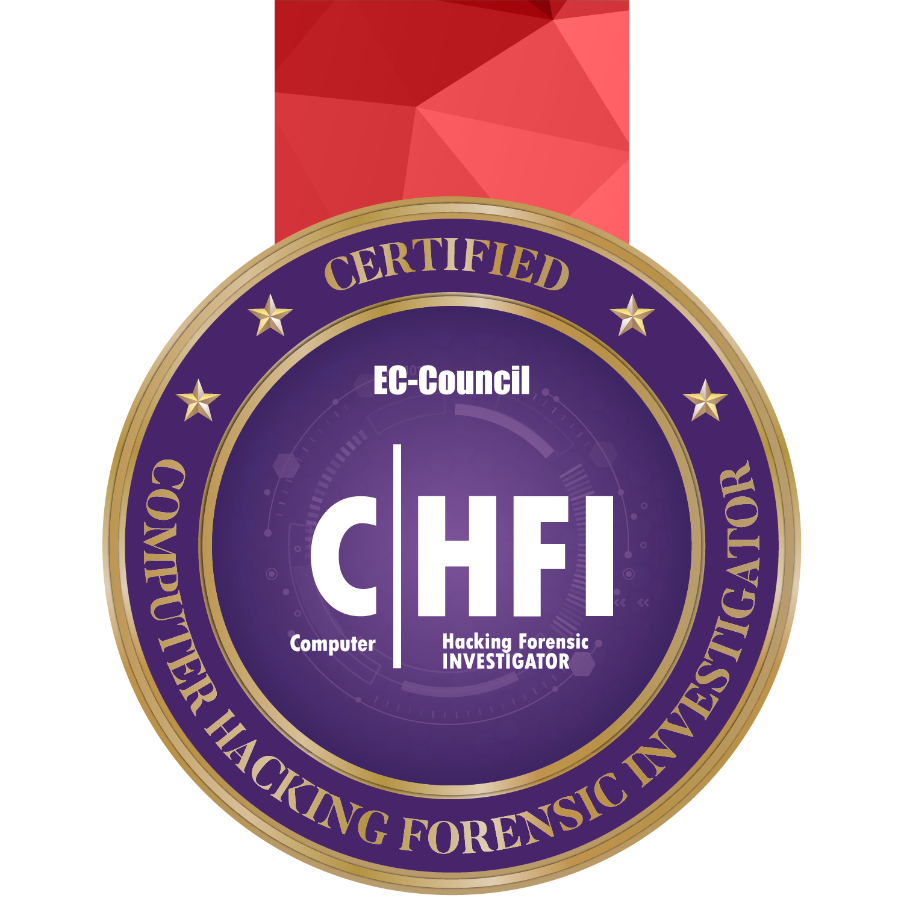

  <!-- Header Banner / Title -->
  <h1>🛡️ NixWarden</h1>
  <h3>Security Platform Architect | Detection & Response Engineering</h3>

  

    <b>Building deterministic, high-throughput security infrastructure where precision meets engineering.</b> 
    Specializing in SIEM/SOAR automation, telemetry optimization (TB-scale OpenSearch/Wazuh), and cloud-native automations.
  

  

    
    
    
  

---

### 👤 About Me

I design and scale deterministic security platforms where detection engineering meets infrastructure precision. My core focus lies in **Security Platform Architecture**, **Detection & Response Engineering**, and bridging enterprise compliance (**ISO/IEC 27001**, **PCI DSS**, **NIST SP 800-61**) with modern containerized and cloud-native automations.

> *"Effective security isn't about blocking everything with blind rules — it's about designing deterministic systems, optimizing telemetry pipelines, and automating away operational friction."*

- 🔭 **Core Focus:** High-throughput SIEM/SOAR platforms, **Cyber Kill Chain**-driven detection & escalation pipelines, and **NIST SP 800-61** incident response workflows.
- 🌐 **Network & Virtualization:** Designing segmented **Proxmox VE** environments using **Router-on-a-Stick** topologies—handling L2 bridging at the hypervisor layer and L3 routing via **WireGuard** inside hardened **LXC** containers.
- ✍️ **Technical Writing:** Publishing analyses on **Medium** (3 articles published) covering digital forensics, practical limits of AI in security, and mobile memory protection.
- 🎓 **Active Certifications:** **CompTIA Security+ ce** & **EC-Council CHFI v11** (Computer Hacking Forensic Investigator).

---

### 📜 Certifications & Credentials

  <table width="100%">
    <tr>
      <td align="center" width="50%" valign="top">
         
        
          
        <h3>CompTIA Security+ ce</h3>
        <b>Security Architecture &amp; Operations</b> 
        ISO/IEC 17024 · DoD 8570.01-M Baseline
          
      </td>
      <td align="center" width="50%" valign="top">
         
        <!-- Official EC-Council CHFI v11 Digital Badge -->
        
          
        <h3>EC-Council CHFI v11</h3>
        <b>Computer Hacking Forensic Investigator</b> 
        ANSI 17024 · Digital Forensics &amp; IR
          
      </td>
    </tr>
    <tr>
      <td align="center" width="50%">
        
      </td>
      <td align="center" width="50%">
        
      </td>
    </tr>
  </table>

---

### 🛠️ Core Tech Stack & Tooling

| Domain | Technologies & Frameworks |
| :--- | :--- |
| **SIEM & Log Optimization** |    |
| **SOAR & Incident Response** |     |
| **Cloud & Automations** |      |
| **Virtualization & Networking** |      |
| **Engineering & Scripting** |      |
| **Frameworks & Compliance** |       |

---

### 🚀 Featured Open Source Projects

Here are key open-source projects maintained on [GitHub](https://github.com/nix-warden):

<table width="100%">
  <tr>
    <td width="50%" valign="top">
      <h3>📋 <a href="https://github.com/nix-warden/NixWarden-Wazuh-Rules">NixWarden-Wazuh-Rules</a></h3>
      
<b>The "Golden Ruleset" for production Wazuh deployments.</b>

      <ul>
        <li><b>Namespace Management:</b> Strict collision-free rule ID ranges (100,000–199,999) preventing manager service failures.</li>
        <li><b>Noise Reduction:</b> Performance-optimized detection logic achieving high signal-to-noise ratio in high-load clusters.</li>
        <li><b>Threat Mapping:</b> 100% tagged with adversary techniques for structured hunt queries and detection engineering.</li>
      </ul>
    </td>
    <td width="50%" valign="top">
      <h3>🔌 <a href="https://github.com/nix-warden/wazuh-custom-integrations">wazuh-custom-integrations</a></h3>
      
<b>Curated aggregator of verified third-party integrations for Wazuh.</b>

      <ul>
        <li><b>Vendor-Backed Scripts:</b> Curated integration modules accompanied by step-by-step production setup guides.</li>
        <li><b>DFIR-IRIS Integration:</b> Automated REST API alert forwarder with field mapping tables and validation tests.</li>
        <li><b>Modular Architecture:</b> Structured contribution model supporting official security platforms (MISP, Shuffle, IRIS).</li>
      </ul>
    </td>
  </tr>
  <tr>
    <td width="50%" align="center" valign="middle">
      
      
    </td>
    <td width="50%" align="center" valign="middle">
      
      
    </td>
  </tr>
</table>

---

### 📝 Technical Articles (Medium)

I write about digital forensics, the practical limits of AI in security, and hardware/OS defense mechanisms:

- 📰 **[Failing the CHFI Taught Me How to Actually Study Forensics (and Clear the Retake in 2.5 Hours)](https://medium.com/@NixWarden/failing-the-chfi-taught-me-how-to-actually-study-forensics-and-clear-the-retake-in-2-5-hours-608c8aab319d)**  
  *Lessons from overcoming the CHFI v11 exam setback and building a structured, hands-on digital forensics methodology.*

- 📰 **[The Illusion of Autonomy: How AI Is Changing the Rules in Tech, Security, and Talent](https://medium.com/@NixWarden/the-illusion-of-autonomy-how-ai-is-changing-the-rules-in-tech-security-and-talent-2f2e81cf3124)**  
  *Separating real automation value from hype—how AI reshapes engineering workflows, security operations, and talent evaluation.*

- 📰 **[Smartphones Memory Protection at the End of 2025: iPhone 17 vs. Samsung vs. Other Android Devices](https://medium.com/@NixWarden/smartphones-memory-protection-at-the-end-of-2025-iphone-17-vs-samsung-vs-other-android-devices-8557019b62be)**  
  *A comparative deep dive into hardware-assisted memory safety, MTE/PAC implementations, and exploit mitigation across flagship mobile ecosystems.*

👉 *Follow my publications on [Medium (@NixWarden)](https://medium.com/@NixWarden)*

---

### 💼 Career Snapshot

- **Security Platform Architect / Detection & Response Engineer** @ **Tier-1 Fintech & Payment Gateway** *(Confidential)*  
  *Dec 2025 – Present*  
  - Reduced `auditd` log volume by >95% through targeted analysis rule optimization and offloading integrity tracking to **Wazuh FIM** without losing security observability; resolved OpenSearch indexing bottlenecks.  
  - Mapped real-time threat detections to the **Cyber Kill Chain**, establishing structured event severity escalation tiers and automated response workflows via Open Source **SOAR** and **IR platform**.  
  - Engineered serverless cloud security automations (AWS Lambda / CloudTrail) and compliance controls aligned with **ISO/IEC 27001**, **PCI DSS**, and **NIST SP 800-61** incident handling.  
  - Investigated multi-stage threats and zero-day vulnerabilities to extract actionable IOCs and prepare regulator-ready forensic dossiers.

- **SOC Solution Architect & Tech Lead** @ **European MSSP & SOCaaS Provider**  
  *Aug 2025 – Dec 2025*  
  - Designed and deployed multi-tenant, multi-client Wazuh SIEM with centralized CCS environment.  
  - Modeled hardware sizing, network segmentation (TLS, routing, cluster roles), and TCO for SOCaaS.

- **Cyber Defense Engineer & Junior Engineer** @ **Cyber Security & Software Defense Firm**  
  *Jun 2021 – Jun 2025 (4 yrs 1 mo)*  
  - SIEM deployment & maintenance, internal infrastructure audits, CI/CD security improvements, incident handling.

---

### 📊 GitHub Activity & Statistics

  

  

  

---

### 📬 Get In Touch

- 🐙 **GitHub:** [github.com/nix-warden](https://github.com/nix-warden)
- ✍️ **Medium:** [medium.com/@NixWarden](https://medium.com/@NixWarden)
- 📧 **Encrypted Contact:** [nixwarden@protonmail.com](mailto:nixwarden@protonmail.com)

  Designed with precision. Always learning, building, and automating.

